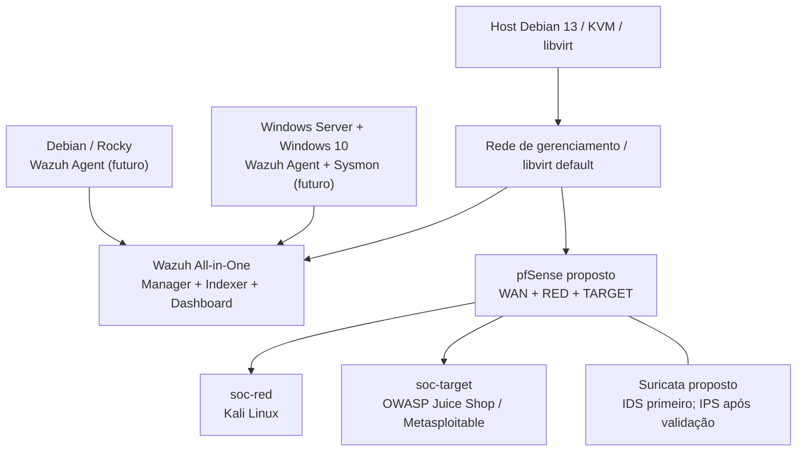

# Topologia proposta — SOC e Red Team

> **Status: planejamento.** As redes, firewall, IDS, máquina atacante e alvos abaixo ainda não foram implantados.

## Objetivo

Criar um ambiente Red Team/Blue Team isolado em que o tráfego de testes passe por um firewall/IDS, os endpoints produzam telemetria e o Wazuh centralize eventos para triagem e investigação.

## Segmentos propostos

| Segmento | Prefixo proposto | Função |
|---|---|---|
| Gerenciamento | libvirt `default` (NAT) | Wazuh, administração e serviços de suporte |
| `soc-red` | `192.168.130.0/24` | Kali Linux e ferramentas de teste |
| `soc-target` | `192.168.140.0/24` | Aplicações e sistemas vulneráveis de laboratório |

Os prefixos precisam ser conferidos contra redes físicas, VPNs e redes virtuais existentes antes da criação.

## Diagrama pretendido

## Componentes previstos

- **pfSense:** roteamento entre zonas, firewall stateful, NAT e regras mínimas.
- **Suricata:** IDS inicialmente. Modo IPS somente depois de observar falsos positivos e validar política de bloqueio.
- **Kali Linux:** estação de testes restrita aos alvos próprios e autorizados.
- **OWASP Juice Shop:** alvo inicial para segurança de aplicações web.
- **Metasploitable 2:** alvo adicional para testes controlados de serviços.
- **Sysmon:** telemetria de processos, conexões e eventos dos endpoints Windows.
- **Wazuh Agent:** coleta/encaminhamento de eventos dos endpoints.

## Princípios de isolamento

1. Kali e alvos devem ficar em segmentos virtuais distintos.
2. Não conectar redes de ataque/alvos diretamente à bridge física doméstica.
3. O tráfego entre Kali e alvos deve atravessar o pfSense para que a inspeção de rede o observe.
4. Bloquear acesso dos alvos à rede doméstica e à Internet por padrão.
5. Permitir apenas o fluxo de gerenciamento necessário ao Wazuh.
6. Manter o Dashboard restrito à rede de gerenciamento.
7. Não expor serviços vulneráveis à Internet.

## Ordem recomendada

1. Validar os três serviços Wazuh e a autenticação.
2. Integrar primeiro um endpoint Linux e, depois, os endpoints Windows.
3. Instalar Sysmon nos Windows e validar coleta no Wazuh.
4. Criar as redes virtuais isoladas e a VM pfSense.
5. Instalar Suricata em modo IDS e integrar logs ao SIEM.
6. Criar Kali e Juice Shop e realizar um primeiro teste de reconhecimento limitado.
7. Correlacionar alertas de rede, endpoint e aplicação.
8. Adicionar outros alvos e cenários conforme a capacidade do host.

## Capacidade e preservação

O host possui 16 GB de RAM; o Wazuh está configurado com 8 GiB. Evitar iniciar simultaneamente todas as VMs de NOC, Windows, pfSense, Kali e alvos. O Samsung N150P deve continuar com Debian minimal, AdGuard Home, Tailscale e monitoramento Zabbix; não convertê-lo em pfSense nem interromper o serviço DNS existente.
